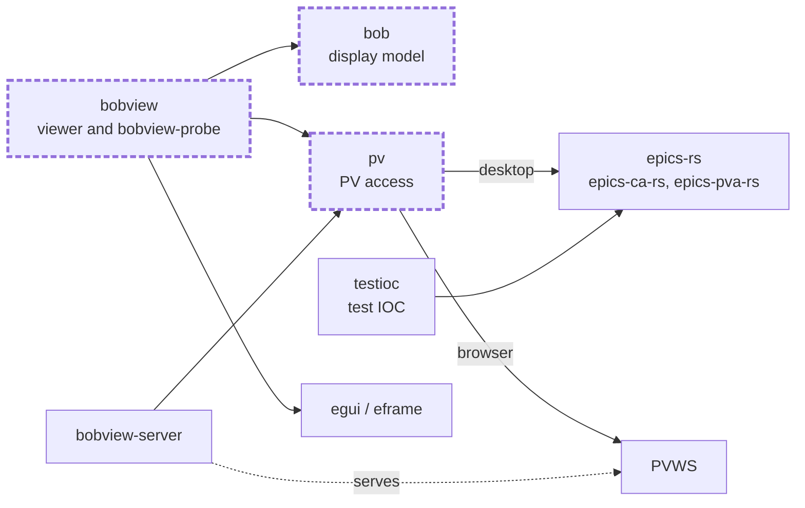
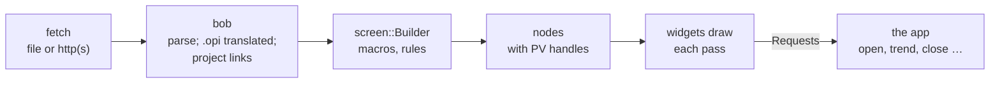

# Architecture

bobview is a Cargo workspace of five crates. Three are published under
longer names, as `bob` and `pv` were taken on crates.io, but keep their short
names in code: `bob` is `bobview-bob`, `pv` is `bobview-pv` and `testioc` is
`bobview-testioc`.

| crate | what |
| --- | --- |
| `bob` | the display model: reads `.bob` files and translates `.opi` ones into the same form, expands macros, resolves Eclipse project links and DLS launchers |
| `pv` | PV connections behind one interface: Channel Access, PV Access, PVWS for the browser, `loc://`, `sim://` and formula PVs |
| `bobview` | the viewer: an [egui](https://github.com/emilk/egui) app that draws displays, plus `bobview-probe` |
| `bobview-server` | serves the web build, `.bob` files and a PV Web Socket from one port |
| `testioc` | `bobview-testioc`, a pure-Rust IOC serving the example-services BL01T PVs |

The crates with a dashed outline also build for `wasm32-unknown-unknown`.
Which source file does what is listed in the
[source map](../reference/api.md#source-map).

## From file to screen

1. `bobview` reads a display from a file or over http(s), off the UI
   thread, and `bob` parses it into a tree of widgets with their
   properties. An `.opi` is translated as it is read, so everything after
   this sees only the `.bob` form. Files a display names are found through
   its Eclipse project's linked folders.
2. The screen builder expands macros down the tree, compiles each widget's
   rules and asks `pv` for its PVs, giving a tree of nodes that each hold
   their PV handles. Embedded displays are built on threads of their own.
3. Each pass, the widgets read their PVs' latest values and draw. A rule is
   evaluated again only when one of its PVs has changed. What a click
   asks for (open a display, show a trend, close the window) goes back to
   the app as a `Request`.

A window is drawn again only when something it shows changes; see
[Threads, windows and repaints](repaints.md).

Rules are expressions over a widget's PVs, evaluated in `bobview`, that set
one of its properties. Formula PVs (`=expr`, `eq://expr`) are PVs made by
`pv` from other PVs; see [Macros, rules and PV types](../reference/macros-rules-pvs.md).

## Protocols

`pv`'s `ca.rs` and `pva.rs` are thin adapters over the
[epics-rs](https://github.com/epics-rs/epics-rs) `epics-ca-rs` and
`epics-pva-rs` crates, which do the protocol work. These are young, so
protocol correctness rests largely on them; the `interop` CI job tests
against other EPICS implementations.

## In the browser

`bob`, `pv` and `bobview` build for the browser, drawn with WebGL. A browser
can't speak CA or PVA, so there PVs come over a
[PV Web Socket](https://github.com/ornl-epics/pvws) (PVWS), as in Daedalus.
`bobview-server` provides one at `/pvws/pv`, reaching PVs through the same
`pv` crate as the desktop viewer; any other PVWS server works too. `loc://`
and `sim://` PVs are made in the page itself. There is one window, and
displays are fetched without blocking the page.

## The test IOC

`bobview-testioc` serves enough of the
[epics-containers example-services](https://github.com/epics-containers/example-services)
BL01T beamline for its screens, over CA and PVA, with no C dependencies. It
runs natively on an aarch64 phone, where the real amd64 IOC containers would
need qemu, and CI uses it to snapshot every test display. See
[bobview-testioc](../reference/testioc.md).

## Design choices

- **egui, immediate mode.** Each pass draws the display from its nodes
  and the PVs' latest values, with no retained widget tree to keep in step.
  It gives one code base for the desktop, the browser and headless
  snapshots, from a small binary.
- **Thin adapters of our own over epics-rs**, rather than bindings to the C
  libraries: no C toolchain, easy cross-builds, and one `pv` interface for
  every PV type.
- **Images are decimated** to at most 2048 pixels a side before they are
  uploaded as a texture.
- **Fidelity is tuned by eye** against Phoebus, not pixel for pixel; see
  [Scope and fidelity to Phoebus](scope.md).
