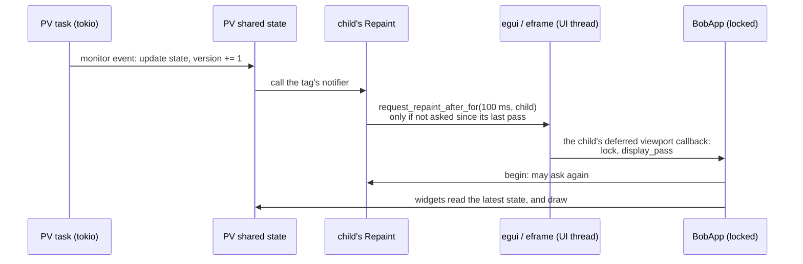

# Threads, windows and repaints

egui draws a window only when asked to. This page explains who asks, and
the locking that lets several windows share one app. It is for
contributors; the user's view is in
[Pinned windows and the viewer](windows.md#redrawing).

## PV updates

A `PvManager` owns a tokio runtime (two worker threads, `bobview-pv`) with
one task per CA or PVA PV, talking to the epics-rs client. Each monitor
event updates the PV's shared state under its lock and bumps its version
(`Shared::update` in `crates/pv/src/lib.rs`). The UI thread never waits on
the network: each pass, widgets copy out the latest state.

Each window subscribes its PVs through its own handle,
`PvManager::tagged(notifier)`, so each PV knows which windows show it. An
update calls the notifiers of those windows only. A window's notifier
(`Repaint` in `app.rs`) asks egui for one repaint of that window, 100 ms
later, and asks no more until the window's next pass begins; so a window
is redrawn for its PVs at most about 10 times a second, however fast they
change. When a window shows another display, its handle is retagged, so the
old display's PVs stop repainting it. A notice (a refused or failed write)
calls every window's notifier, so each shows it.

## Windows

The main window is eframe's root viewport. Each display and trend window is
a deferred viewport (`show_viewport_deferred`) with a pass of its own, so it
is redrawn for its own input and PVs, not when another window is. The app,
`BobApp`, sits behind one `Arc<Mutex<_>>` (`app::App`): each window's pass
locks it. eframe runs the passes one after another on the UI thread, so they
never wait for each other.

Three rules keep this working:

1. **Never hold the lock while calling `show_viewport_deferred`.** Where
   windows are embedded, egui runs the callback at once, inside the
   caller's pass, and the callback takes the lock. The main window's pass
   returns the windows to keep open, and `App::draw` registers them after
   letting go.
2. **Windows open from the main window's pass.** A link in a child window
   adds the new window to the app, and the main window registers it on its
   next pass. So a pass that changes the windows open or their titles
   repaints the main window.
3. **A change to another window repaints it.** Each pass compares a small
   `Shape` (windows, what each shows, trend titles, where the PV details
   dialog is) before and after, and repaints the windows whose part
   changed.

**Embedded mode** has one native window: the browser, snapshots and unit
tests (a plain `egui::Context` embeds). There, display and trend windows are
`egui::Window`s drawn in the main window's pass, and every repaint is of the
main window.

## Other repaint sources

Work on other threads asks for a repaint by viewport id, because a bare
`request_repaint` there reaches whichever window egui is drawing:

- the image-loader threads (`symbol.rs`), which read the SVG and PNG files
  of symbol and picture widgets, repaint each window waiting for an image;
- the navigator's and command launchers' threads repaint the main window.

A window also polls while it waits: a display being fetched or built, an
embedded display building on its thread, or a fetch in the browser asks
for a repaint every 50 ms until it arrives. Strip charts scroll by asking
for the next repaint when the plot has moved a pixel.

A trend window's plot is archiveview's `Plot`, built on the trend window's
own tagged `PvManager`, so its PVs repaint only that window. It repaints
itself for the rest: archive fetches run on the `pv` crate's runtime and
ask for a repaint of the viewport the plot was last drawn in, and a live
plot asks for the next repaint as it scrolls (at up to 15 frames a second,
and while the pointer is over it).

Where windows are embedded, a trend's plot is drawn in the main window, so
each repaint it asks for itself redraws the whole display: there
`Trend::ui` holds them to a strip chart's floor, `MIN_SCROLL_REPAINT`
(0.25 s), with `Plot::set_min_repaint_interval`. A trend in its own native
window repaints only itself, and keeps the plot's own pace. Repaints for
the user's pans and zooms, and for a fetch finishing, are not held back.
